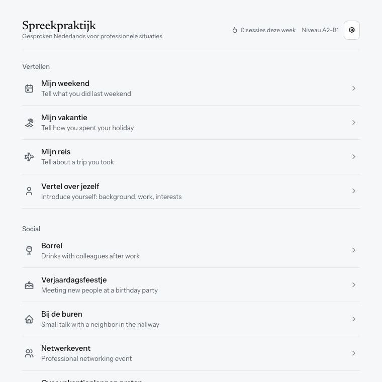
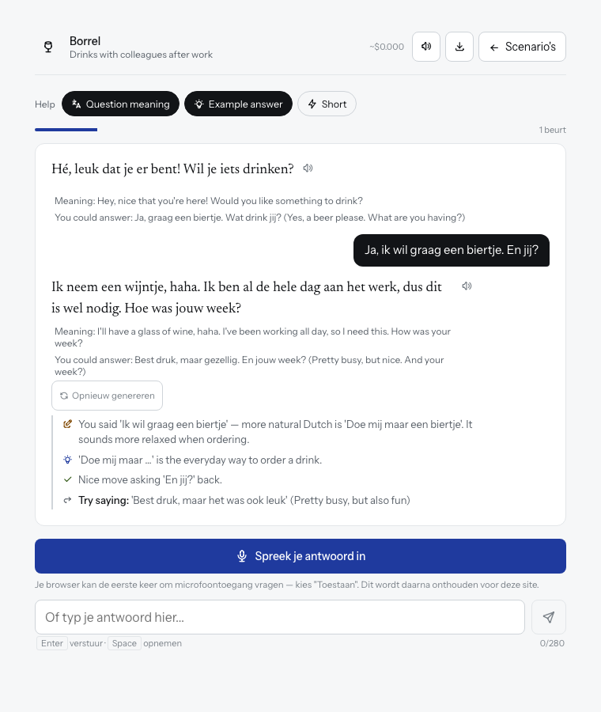

# Spreekpraktijk

Practise speaking Dutch by talking with an AI partner. You pick a situation, such as drinks with colleagues or a visit to the town hall, and have a conversation. After each reply you get short feedback in English.

It's made for A2–B1 level. It runs in your browser, with nothing to install.

## Before you start

You need:

1. **A browser.** Chrome or Edge works best, especially for speaking. Safari works but understands Dutch less well.
2. **An API key.** This is a password that lets the website use an AI model. The AI company charges you a small amount for what you use. A short conversation usually costs a fraction of a cent.

### Getting a key

Pick one provider. The key popup has a link for each.

| Provider | Where to get a key |
|---|---|
| OpenRouter | openrouter.ai/keys |
| Google Gemini | aistudio.google.com/apikey |
| Anthropic (Claude) | console.anthropic.com → Settings → API Keys |

If you're unsure, choose Google Gemini or OpenRouter.

## System check

The introduction page runs a quick check before you start. It shows a tick, a warning or a cross for:

- **Voice input:** whether your browser can listen to you.
- **Spoken replies:** whether a Dutch voice is installed.
- **Internet:** whether you're online.
- **Microphone:** click **Test my microphone** to check it works. Your browser may ask for permission.
- **Secure page:** microphones only work on https pages.

A warning doesn't stop you. For example, without voice input you can type your answers.

## First-time setup

1. Open the website. You'll see a short introduction page.
2. Click **Start practising**.
3. In the popup, choose a **provider** and a **model**, and paste your **API key**.
4. Click **Opslaan en starten**.

Your key stays in your own browser, on your own device. The website never stores it or uses it itself. Your browser sends it straight to the provider you chose, and nowhere else. Use your own key and don't share it. Consider setting a spending limit for it on the provider's website.

Next time you visit, the introduction page is skipped and you go straight to the scenario list. To change your key, click the settings icon (the cog) at the top of the list.

## Having a conversation

1. **Pick a scenario** from the list. They're grouped by topic. *Vertellen* is for telling longer stories, such as your weekend, your holiday or yourself.
2. **Read or listen to the first line.** The character speaks first.
3. **Answer** in one of two ways:
   - Click **Spreek je antwoord in** and speak. It keeps listening, even if you pause. Click again when you're done. Your words appear in the text box.
   - Or type in the box.
4. **Send.** After you speak, the message sends by itself after 5 seconds. To change it first, click in the text box or press **Annuleren**. Then edit and press Enter.
5. Read the **feedback** under the reply, then keep talking.

The first time you use the microphone, your browser asks for permission. Choose **Toestaan**.

The character reacts to what you say, shares things about itself, and answers your questions. It doesn't only ask questions, so ask things back.

### Vertellen: telling longer stories

In the *Vertellen* scenarios you give bigger answers.

- The text box takes up to 1000 characters, instead of 280.
- Nothing is sent automatically. Check your text, add more if you like, then press Enter.
- The character listens and asks at most one follow-up question.
- Corrections cover the 3 most important mistakes in your answer.

## The feedback under each reply

- **Correction:** a mistake in what you said, with the better version.
- **Tip:** a useful word or phrase for this situation.
- **Encouragement:** a short note when you did well.
- **Try saying:** an idea for what to say next, often one that answers and also asks the character a question back.

## Help buttons

Above the chat, three buttons under **Help** turn extra help on or off. A filled button means it's on. Your choice is remembered.

- **Question meaning:** shows the English meaning of what the character said.
- **Example answer:** shows an example Dutch reply you could give.
- **Short:** makes replies shorter and cheaper.

Try the conversation with the help off first. Turn it on when you're stuck.

## Summary

The summary never appears on its own. To see it:

1. Click the **list icon** at the top of the chat.
2. A panel shows the corrections and the good words and phrases from the whole conversation so far.
3. Click **Download** in the panel to save it as its own text file. Click the **X** to hide it.

The summary is a separate file from the conversation download.

## Every button

- **Settings (cog):** on the scenario list. Change your provider, model or API key.
- **Spreek je antwoord in:** starts recording. Click again to stop.
- **Send (paper plane):** sends your message. Enter does the same.
- **Annuleren:** shown for 5 seconds after you speak. Stops the automatic send so you can edit first.
- **Question meaning, Example answer, Short:** the help buttons described above.
- **Speaker icon (top right):** turns spoken replies on or off.
- **List icon:** shows or hides the summary.
- **Download icon:** saves the conversation as a text file.
- **Scenario's:** goes back to the list. This clears the current chat.
- **Small speaker next to a reply:** plays that line again.
- **Opnieuw genereren:** under the latest reply. Asks for a new reply and puts your message back in the box so you can change it.
- **Opnieuw:** appears after an error. Tries sending your last message again.
- **X (in the summary):** closes the summary.

Hover over any icon to see what it does.

## Tips

- Speak steadily. A headset or a microphone close to your mouth helps a lot.
- Voice recognition sometimes mishears Dutch. Check the text before sending. If it offers other options under the box, pick the one you really said.
- You can't break the conversation. Try unexpected answers. The character follows you.
- If something goes wrong, press **Opnieuw** to retry the last message.
- Your chat stays if you reload the page. It's cleared when you go back to the scenario list.

## If something doesn't work

| Problem | What to try |
|---|---|
| The microphone does nothing | Allow microphone access in the browser's address bar, or use Chrome or Edge. |
| iPad or iPhone asks for the microphone every time | In Safari, tap the **aA** button in the address bar → **Website Settings** → **Microphone** → **Allow**. You can also set it in Settings → Apps → Safari → Microphone. |
| Dutch voice sounds odd | Your device may not have a Dutch voice installed. The text still works. |
| Error after sending | Check that your key is correct and has credit. Then try again. |
| No microphone button | Your browser doesn't support voice input. Type your answers instead. |
| The page looks old after an update | Reload once. The page checks for a new version each time it opens. |

## For people hosting it

It's a single static page, `index.html`, so it works on GitHub Pages with no server. Every visitor enters their own API key, which stays in their own browser, so many people can use the same link at once. Don't put a key in the page or the repo. Ideas for later improvements are in [improvement.md](improvement.md).
